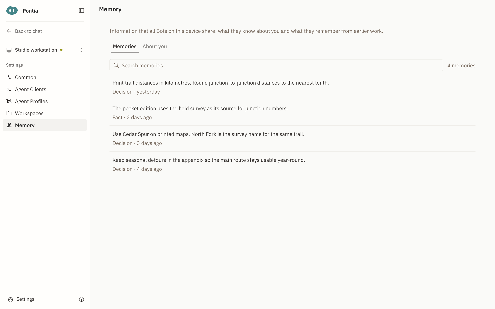
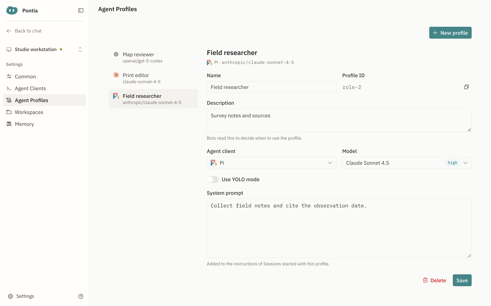
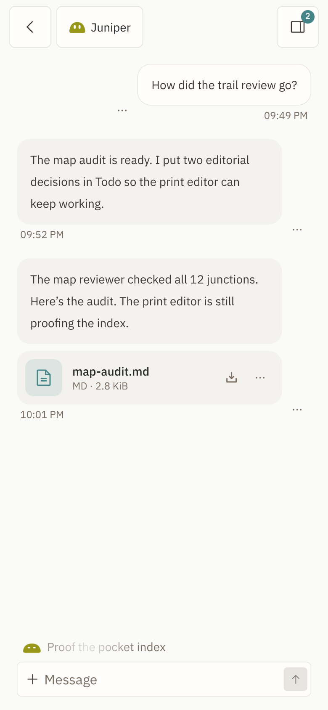
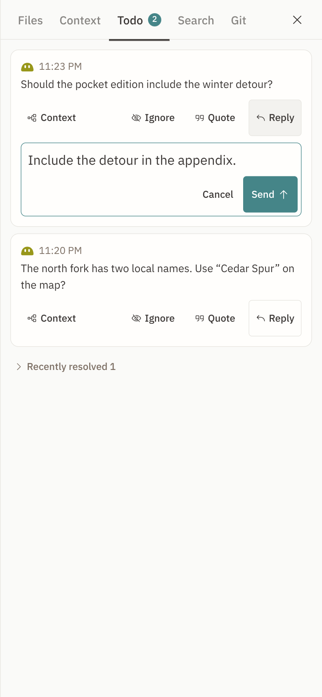

<div align="center">
  
  <h1>Pontia</h1>
  <p><strong>常驻你开发机上的 Lead Bot：拆任务、派隔离 Helper 并行干活，驱动本机 6 大原生编程 CLI。</strong></p>
  <p><a href="https://pontia.dev/zh">官网</a> · <a href="https://app.pontia.dev">打开 Dashboard</a> · <a href="README.md">English</a></p>
</div>

用多个终端同时盯 Claude Code、Codex 跑任务、切窗口回确认，精力很容易被切碎。Pontia 在你自己的开发机上常驻一个 **Lead Bot**：你只管交代目标，它把任务拆给上下文隔离的 **Helper** 并行执行、收回报告与文件，把需要你拍板的问题收进 **Todo** 队列；离开工位后，用手机或电脑浏览器登录 Dashboard 就能接着聊，并在多台已注册设备间随时切换。

```sh
npx @pontia/cli init
```

在已登录编程 CLI 的机器上运行即可完成客户端接入、本地服务启动与设备注册，并自动打开 Dashboard。浏览器登录 Pontia 账号即连，省去配置聊天机器人 Token 的步骤。[查看环境要求](#环境要求)

**端到端加密与私有 Edge**：浏览器与目标设备是端到端加密的两端，代码、工作区与文件都留在你自己的机器上，Agent 工具按本机配置的权限运行。Pontia Cloud 负责账号登录与连接授权，Edge 作为零知识中继，仅转发密文、路由元数据、流量大小和时序。你可以直接使用官方 Edge，也可以自托管私有 Edge。[安全模型](https://pontia.dev/zh/docs/security) · [自托管 Edge](https://pontia.dev/zh/docs/self-hosted-edge)


## 核心能力

| 能力 | 说明 |
| --- | --- |
| **Lead Bot + 隔离 Helper + Todo 决策流** | 在一个长期会话里向 Lead Bot 交代项目，它按需派出上下文隔离的 Helper 并行处理并收回产出；需要你定夺的分歧自动归入 Todo 队列，其余 Helper 照常推进，你随时逐项回复即可。 |
| **Agent Profiles 统一接管 6 大原生 CLI** | 将角色指令、客户端、模型和推理强度存成 Profile，供 Helper 与工作流步骤直接复用。原生接入本机已登录的 **Claude Code、Codex、Pi、Google Antigravity、Kiro、Grok Build**。 |
| **跨会话记忆图谱与 `USER.md`** | 同机 Bot 共享跨会话长期记忆图谱，自动关联事实、决策和经验，可在设置中随时检索；把个人偏好与长期规范写进 `USER.md`，每次协作都会自动遵循。 |
| **多设备零配置远程接管** | 在同一个浏览器里切换你名下的多台开发机，每台机器独立运行各自的 CLI 与本地工作区，随时随地查看进度、审阅产出、处理 Todo。 |

<table>
  <tr>
    <td width="50%" valign="top"><a href="assets/screenshots/shared-memory.webp"></a><br><strong>在跨会话记忆图谱中检索过往决策</strong></td>
    <td width="50%" valign="top"><a href="assets/screenshots/role-profiles.webp"></a><br><strong>为角色配置 CLI、模型与推理强度</strong></td>
  </tr>
  <tr>
    <td width="50%" valign="top"><a href="assets/screenshots/private-edge.webp"></a><br><strong>查看自托管私有 Edge 的运行状态</strong></td>
    <td width="50%" valign="top"><a href="assets/screenshots/helper-decisions.webp"></a><br><strong>Helper 并行工作时，随时回复 Todo 决策</strong></td>
  </tr>
</table>

## 一次完整协作：从派活到手机拍板

**周五，你给 Lead Bot Juniper 派活**：“周六要用 Luma 徒步手册，帮我核对路线图，再把口袋版校对一遍。”

**Juniper 拆任务、派 Helper 并行**：地图校对员用 **Codex** 核查岔路口名称，排版编辑用 **Claude Code** 检查页码引用，两名 Helper 各自运行在独立上下文里。地图校对员发现同一条步道有两个名字，Juniper 把定名问题放进 **Todo**，先交回完整的核对报告；排版编辑照常继续校对索引。

**稍后，你在手机上收尾**：打开浏览器看完核对报告，在定名 Todo 里回复“用 Cedar Spur”，冬季绕行路线留到稍后再定。下次再维护这本手册时，Juniper 会从记忆图谱中调出这次定名决策，并按 `USER.md` 里的个人规则统一用公里标注里程。

<p align="center">
  <a href="assets/screenshots/phone-report.webp"></a>
  <a href="assets/screenshots/phone-decisions.webp"></a>
  <a href="assets/screenshots/phone-devices.webp"></a>
</p>

## 快速开始

### 环境要求

- **操作系统**：Linux（x86_64 或 ARM64），或 macOS 13.5 及以上（Intel 或 Apple Silicon）。
- **服务管理**：Linux 需启用 systemd 用户服务；macOS 使用用户级 LaunchAgent。
- **安装工具**：推荐使用 `npx` 安装，需 Node.js 与 npm；未安装 Node.js 时可使用 [Shell 脚本安装](#使用-shell-脚本安装)。

初始化前，先在本机装好要接入的原生 CLI 客户端：

- **pi**：安装 `pi` CLI 和 `tmux`
- **Codex**：安装 `codex` CLI
- **Claude Code**：安装 Node.js LTS 与 npm，并完成 Claude Code 登录
- **Grok Build（ACP）**：将 `grok` 安装到服务用户的 `PATH` 中，初始化后按 [Agent Clients](https://pontia.dev/zh/docs/agent-clients#enable-an-acp-agent) 启用
- **Google Antigravity（ACP）**：将 `agy` 安装到服务用户的 `PATH` 中，初始化后在 [Agent Clients](https://pontia.dev/zh/docs/agent-clients) 中启用
- **Kiro（ACP）**：将 `kiro-cli` 安装到服务用户的 `PATH` 中，运行 `kiro-cli login` 登录，初始化后在 [Agent Clients](https://pontia.dev/zh/docs/agent-clients) 中启用

### 初始化

`pontia init` 会自动安装所选客户端的集成、启动本地服务，并引导你完成账号登录和设备注册。将 `$HOME/.local/bin` 加入 `PATH` 后，后续可随时再次运行 `pontia init` 检查或修复安装。

### 常用命令

查看服务健康状态、当前登录账号、设备远程注册情况与所用 Edge：

```bash
pontia status
```

新装了客户端，或需要重新配置、修复某个客户端连接：

```bash
pontia setup          # 交互选择客户端
pontia setup codex    # 直接指定单个客户端：pi、codex、claude
```

排查异常时运行全面诊断：

```bash
pontia doctor
```

`pontia doctor` 会逐项检查服务、配置、登录态和远程注册，对异常项给出修复建议；设备已注册时还会列出远程 Dashboard 地址。更多排障说明见[故障排查](https://pontia.dev/zh/docs/troubleshooting)。

### 使用 Shell 脚本安装

也可以通过官方签名脚本安装。需要 `curl`、支持 Ed25519 的 OpenSSL 以及系统常规命令行工具：

```bash
curl -fsSL https://get.pontia.dev/install.sh | sh
"$HOME/.local/bin/pontia" init
```

## 手动配置

`pontia init` 已涵盖上述全流程。若需分步执行，或在脚本与 Agent 中做免交互配置，可直接调用以下命令。完整分步流程见[初始化文档](https://pontia.dev/zh/docs/initialization#non-interactive-initialization)，全部命令见 [CLI 参考](https://pontia.dev/zh/docs/cli)。

| 命令 | 用途 |
| --- | --- |
| `pontia up` / `pontia down` | 启动或停止 Pontia 本地服务 |
| `pontia login` | 登录 Pontia Cloud |
| `pontia remote enable` | 注册当前设备并开启远程访问 |
| `pontia update` | 将 CLI 与服务更新至最新签名稳定版 |

### Shell 自动补全

将对应 Shell 的补全命令加入配置文件，重新打开终端即可生效：

```bash
# bash：加入 ~/.bashrc
source <(pontia completions bash)

# zsh：加入 ~/.zshrc，放在 compinit 之后
source <(pontia completions zsh)

# fish：执行一次即可
mkdir -p ~/.config/fish/completions
pontia completions fish > ~/.config/fish/completions/pontia.fish
```

同时支持 Elvish 和 PowerShell，详见 [CLI 参考](https://pontia.dev/zh/docs/cli)。

### 本地 Dashboard

在运行 Pontia 的机器上访问 <http://127.0.0.1:8080/dashboard>。访问令牌由 `pontia init` 自动生成，位于 `$HOME/.pontia/config.toml` 中的 `external_api_token`。

### 配置目录

默认配置文件路径为 `$HOME/.pontia/config.toml`。如需指定其他目录，在运行 `pontia init` 及后续命令前，将环境变量 `PONTIA_HOME` 设为目标绝对路径即可。

## 许可证

Pontia 采用 [Apache License 2.0](LICENSE) 开源协议。
