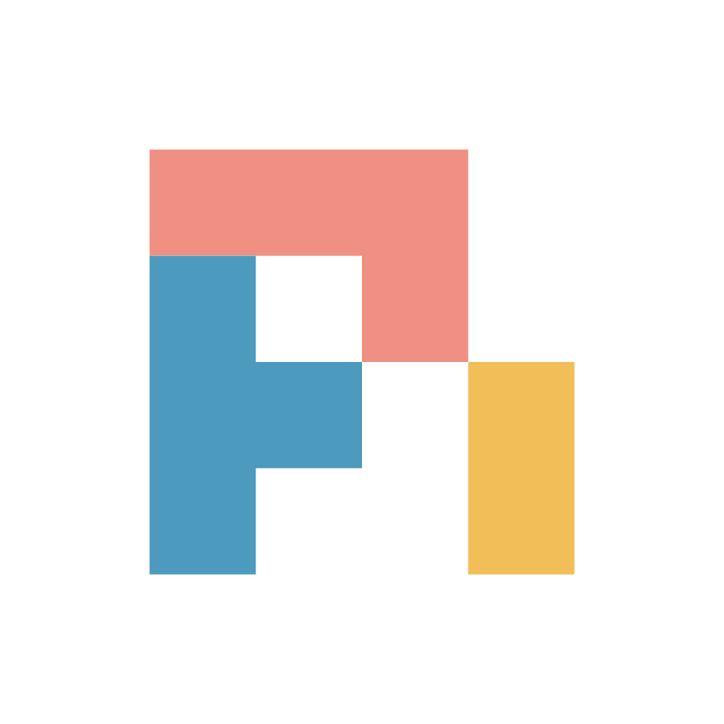
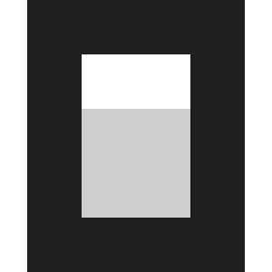

<div align="center">
  
  <h1>Pontia</h1>
  <p><strong>Your device. Your agent cloud.</strong></p>
  <p>
    <a href="LICENSE"></a>
    <a href="https://www.npmjs.com/package/@pontia/cli"></a>
    
  </p>
  <p><a href="https://pontia.dev">🌐 官网</a> · <a href="https://app.pontia.dev">🖥️ Dashboard</a></p>
  <p><a href="README.md">English</a> · 简体中文</p>
</div>

离开工位，agent 不停工。pi、Codex、Claude Code、OpenCode 这些编程 agent 照常在你自己的设备上跑，你在任何浏览器里都能查看进度、批准操作、引导方向，手机上也行。Pontia 免费且开源。

<p align="center">
  
  &nbsp;&nbsp;
  <picture><source media="(prefers-color-scheme: dark)" srcset="apps/cloud/static/client-logos/codex-dark.svg"></picture>
  &nbsp;&nbsp;
  
  &nbsp;&nbsp;
  <picture><source media="(prefers-color-scheme: dark)" srcset="apps/cloud/static/client-logos/opencode-dark.svg"></picture>
  &nbsp;&nbsp;
  
</p>


## 为什么用 Pontia

- 📱 **装进口袋**：把 Dashboard 添加到手机主屏幕。不在电脑前，也能看进度、批准操作、发下一条指令。
- 💳 **用你自己的订阅**：Pontia 不卖模型，也不卖 token。agent 用的是你已经付费的账号和套餐。
- 💻 **终端照常用**：agent 在你的设备上运行，用的是本机的工具和文件。pi、Codex 的 TUI 照常用，对话自动同步到 Dashboard，两边随时切换，不用从头再来。
- 🤖 **把工作交给 Bot**：像和助理聊天一样和设备上的 Bot 对话。它为每件事开启 Session，多件事同时推进，完成后向你汇报，长期对话里也记得你的项目。
- 🔒 **端到端加密**：只有你的浏览器和你的设备能读到会话内容。用官方 Edge 或自己部署都行，Edge 只转发密文。

支持 pi、Codex、Claude Code，以及 OpenCode、Grok Build 等 ACP agent，可在 Linux 和 macOS 上运行。

## 快速开始

### 环境要求

- Linux（x86_64 或 ARM64），或 macOS 13.5 及以上（Intel 或 Apple Silicon）。
- Linux 需要 systemd 用户服务，macOS 使用用户级 LaunchAgent。
- 推荐用 `npx` 安装，需要 Node.js 和 npm。没装 Node.js 可以用 [shell 脚本安装](#用-shell-脚本安装)。

初始化前，先装好要用的客户端：

- **pi**：`pi` CLI 和 `tmux`
- **Codex**：`codex` CLI
- **Claude Code**：Node.js LTS 和 npm，且 Claude Code 已登录
- **ACP agent**：先装好 agent 本身，初始化后按 [Agent Clients](https://pontia.dev/zh/docs/agent-clients#enable-an-acp-agent) 启用

### 初始化

```bash
npx @pontia/cli init
```

一条命令完成全部配置：

1. 把 Pontia 装到 `$HOME/.local/bin`。记得把这个目录加进 `PATH`。
2. 选择客户端并安装对应集成。
3. 启动 Pontia 服务。
4. 登录 Pontia Cloud，注册设备并开启远程访问。

配置成功后会自动打开[远程 Dashboard](https://app.pontia.dev)。已经装过 Pontia 的，直接运行 `pontia init`。重复运行会检查并修复安装，已有配置保持不变。

### 常用命令

查看 Pontia 是否正常运行：

```bash
pontia status
```

会显示服务状态、登录账户，以及这台设备的远程注册情况和所用 Edge。

配置或修复客户端连接，比如新装了客户端，或者某个客户端连不上了：

```bash
pontia setup          # 选择客户端
pontia setup codex    # 也可以直接指定：pi、codex、claude
```

出了问题，运行详细检查：

```bash
pontia doctor
```

`pontia doctor` 会检查服务、配置、登录和远程注册，没通过的检查项会附上修复方法。设备已注册时，还会列出它的远程 Dashboard 地址。更多问题见[故障排查](https://pontia.dev/zh/docs/troubleshooting)。

### 用 shell 脚本安装

没有 Node.js 时，可以用带签名的安装脚本。需要 `curl`、支持 Ed25519 的 OpenSSL，以及系统自带的常用命令行工具。

```bash
curl -fsSL https://get.pontia.dev/install.sh | sh
"$HOME/.local/bin/pontia" init
```

## 手动配置

上面的事 `pontia init` 都会做。想单独执行某一步，或者在脚本、agent 里免交互配置，可以用下面这些命令。完整步骤见[初始化文档](https://pontia.dev/zh/docs/initialization#non-interactive-initialization)，全部命令见 [CLI 参考](https://pontia.dev/zh/docs/cli)。

| 命令 | 用途 |
| --- | --- |
| `pontia up` / `pontia down` | 启动或停止 Pontia 服务 |
| `pontia login` | 登录 Pontia Cloud |
| `pontia remote enable` | 注册当前设备，开启远程访问 |
| `pontia update` | 把 CLI 和服务更新到最新的签名稳定版 |

### Shell 自动补全

把对应 shell 的配置加上，然后打开新终端：

```bash
# bash：加到 ~/.bashrc
source <(pontia completions bash)

# zsh：加到 ~/.zshrc，放在 compinit 之后
source <(pontia completions zsh)

# fish：运行一次即可
mkdir -p ~/.config/fish/completions
pontia completions fish > ~/.config/fish/completions/pontia.fish
```

也支持 Elvish 和 PowerShell，见 [CLI 参考](https://pontia.dev/zh/docs/cli)。

### 本地 Dashboard

在运行 Pontia 的机器上打开 <http://127.0.0.1:8080/dashboard>。访问令牌由 `pontia init` 生成，即 `$HOME/.pontia/config.toml` 里的 `external_api_token`。

### 配置目录

配置文件默认是 `$HOME/.pontia/config.toml`。想换目录，就在运行 `pontia init` 和之后的命令前，把 `PONTIA_HOME` 设成一个绝对路径。

## 许可证

Pontia 采用 [Apache License 2.0](LICENSE) 许可。
