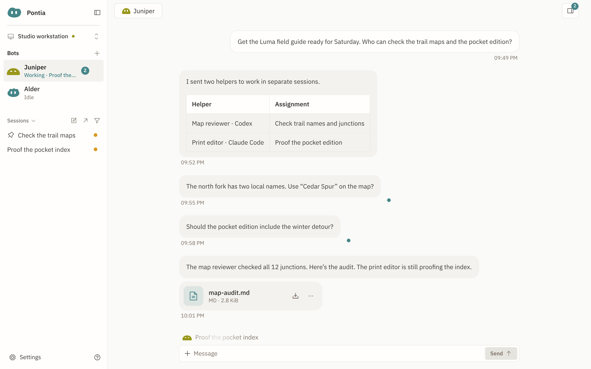
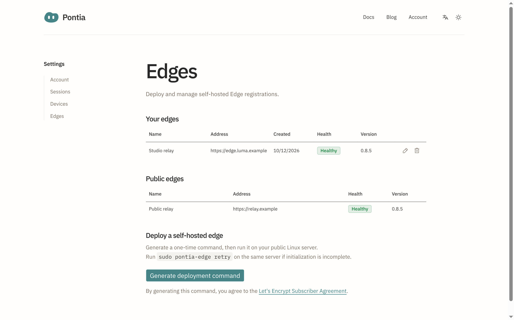
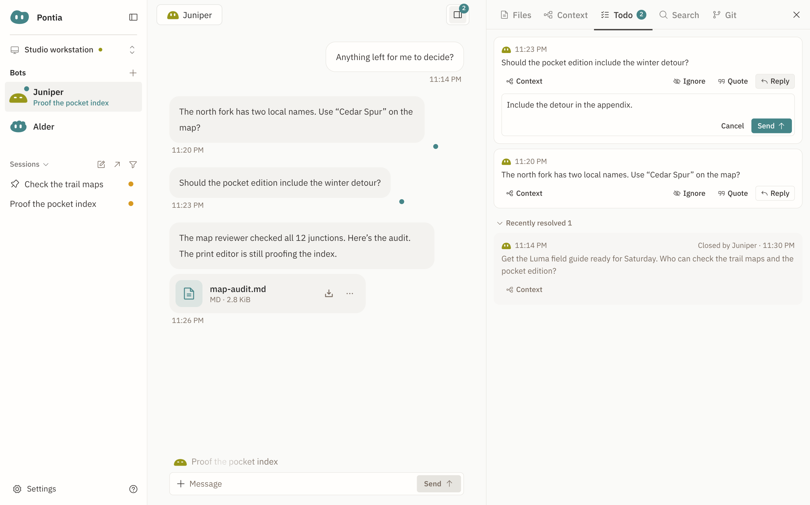
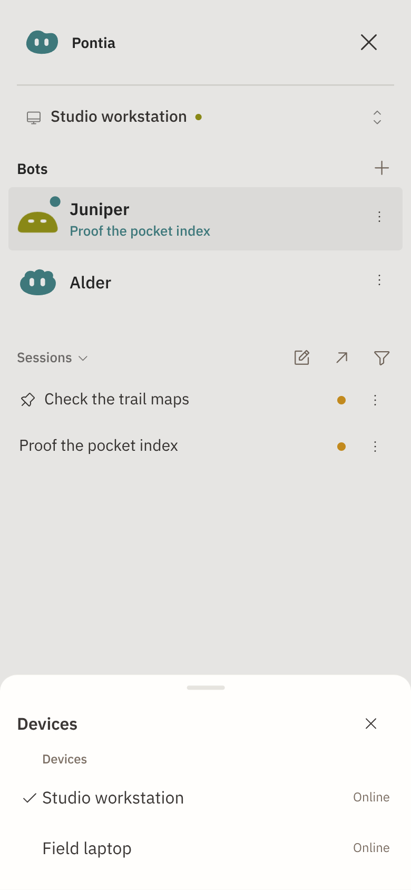

<div align="center">
  
  <h1>Pontia</h1>
  <p><strong>把项目交给自己电脑上的长期搭档。</strong></p>
  <p><a href="https://pontia.dev/zh">官网</a> · <a href="https://app.pontia.dev">打开 Dashboard</a> · <a href="README.md">English</a></p>
</div>

你把项目交给 Lead Bot，它分派 Helper 并行工作，收回文件，把需要你拍板的问题放进 Todo。离开工位后，在手机或电脑浏览器里打开 Dashboard 就能接着聊，也能切换到另一台已注册的设备。

```sh
npx @pontia/cli init
```

在已登录编程 CLI 的电脑上运行这条命令，完成设备注册后会自动打开 Dashboard。浏览器用 Pontia 账号登录，免配聊天机器人 Token。[查看环境要求](#环境要求)

**远程会话谁能读？** 浏览器和选中的设备是端到端加密的两个端点。Pontia Cloud 负责登录和连接授权，Edge 对 Dashboard 内容是零知识中继，只接触密文、路由信息、流量大小和时序。你可以选官方 Edge，也可以自托管私有 Edge。Agent 工具按本机配置的权限运行。[安全模型](https://pontia.dev/zh/docs/security) · [自托管 Edge](https://pontia.dev/zh/docs/self-hosted-edge)



## 一本徒步手册，两名 Helper

**周五，你交代 Juniper**：“周六要用 Luma 徒步手册。谁能核对路线图，再校一遍口袋版？”

**Lead Bot Juniper 分派任务**：地图校对员用 Codex 核对岔路口的名称，排版编辑用 Claude Code 检查页码引用。两名 Helper 各有独立的任务上下文。校对员发现同一条步道有两个名字，Juniper 把定名问题放进 Todo，先交回核对报告。与此同时，编辑继续校对索引。

**稍后，你打开手机**：读完报告，在定名待办里回复“用 Cedar Spur”，冬季绕行路线留到稍后再定。下次再做这本手册，Juniper 能找回步道定名的决定，也能从 `USER.md` 读到你一直沿用的规则——里程统一用公里。

## 协作速览

| 范围 | 你可以做什么 |
| --- | --- |
| Lead Bot | 在同一个长期对话里交代任务、收取 Helper 报告，在 Todo 中逐项回复需要拍板的问题。 |
| 设备记忆 | 同一台设备上的 Bot 共享跨会话记忆图谱，关联事实、决定和经验。在设置里检索记忆条目，在 `USER.md` 编辑个人规则与偏好。 |
| Agent Profiles | 将角色指令、客户端、模型和推理强度存成 Profile，供 Helper 和工作流步骤复用。可以选用本机已登录的 Claude Code、Codex、Pi、Google Antigravity、Kiro 和 Grok Build。 |
| 远程访问 | 在同一个浏览器里切换已注册的机器。每台机器运行自己的 CLI，工作区和文件留在本地。 |

<table>
  <tr>
    <td width="50%" valign="top"><a href="assets/screenshots/shared-memory.webp"></a><br><strong>在记忆库找回步道定名的决定</strong></td>
    <td width="50%" valign="top"><a href="assets/screenshots/role-profiles.webp"></a><br><strong>设置外业研究员的模型与推理强度</strong></td>
  </tr>
  <tr>
    <td width="50%" valign="top"><a href="assets/screenshots/private-edge.webp"></a><br><strong>查看私有 Edge 的健康状态</strong></td>
    <td width="50%" valign="top"><a href="assets/screenshots/helper-decisions.webp"></a><br><strong>编辑继续校对时，回复一项待办</strong></td>
  </tr>
</table>

### 在手机上接着做

<p align="center">
  <a href="assets/screenshots/phone-report.webp"></a>
  <a href="assets/screenshots/phone-decisions.webp"></a>
  <a href="assets/screenshots/phone-devices.webp"></a>
</p>

## 快速开始

### 环境要求

- Linux（x86_64 或 ARM64），或 macOS 13.5 及以上（Intel 或 Apple Silicon）。
- Linux 需要 systemd 用户服务，macOS 使用用户级 LaunchAgent。
- 推荐用 `npx` 安装，需要 Node.js 和 npm。没装 Node.js 可以用 [shell 脚本安装](#用-shell-脚本安装)。

初始化前，先装好要用的客户端：

- **pi**：`pi` CLI 和 `tmux`
- **Codex**：`codex` CLI
- **Claude Code**：Node.js LTS 和 npm，且 Claude Code 已登录
- **Grok Build（ACP）**：将 `grok` 安装到服务用户的 PATH 中，初始化后按 [Agent Clients](https://pontia.dev/zh/docs/agent-clients#enable-an-acp-agent) 启用
- **Google Antigravity（ACP）**：将 `agy` 安装到服务用户的 PATH 中，初始化后在 [Agent Clients](https://pontia.dev/zh/docs/agent-clients) 中启用
- **Kiro（ACP）**：将 `kiro-cli` 安装到服务用户的 PATH 中，用 `kiro-cli login` 登录，初始化后在 [Agent Clients](https://pontia.dev/zh/docs/agent-clients) 中启用

### 初始化

`pontia init` 会安装所选客户端的集成、启动本机服务，并引导你登录和注册设备。将 `$HOME/.local/bin` 加入 `PATH`，以后可以直接运行 `pontia init` 检查和修复现有安装。

### 常用命令

查看 Pontia 是否正常运行：

```bash
pontia status
```

会显示服务状态、登录账户，以及这台设备的远程注册情况和所用 Edge。

配置或修复客户端连接，比如新装了客户端，或者某个客户端连不上了：

```bash
pontia setup          # 选择客户端
pontia setup codex    # 也可以直接指定：pi、codex、claude
```

出了问题，运行详细检查：

```bash
pontia doctor
```

`pontia doctor` 会检查服务、配置、登录和远程注册，没通过的检查项会附上修复方法。设备已注册时，还会列出它的远程 Dashboard 地址。更多问题见[故障排查](https://pontia.dev/zh/docs/troubleshooting)。

### 用 shell 脚本安装

也可以直接运行带签名的安装脚本。需要 `curl`、支持 Ed25519 的 OpenSSL，以及系统自带的常用命令行工具。

```bash
curl -fsSL https://get.pontia.dev/install.sh | sh
"$HOME/.local/bin/pontia" init
```

## 手动配置

上面的事 `pontia init` 都会做。想单独执行某一步，或者在脚本、agent 里免交互配置，可以用下面这些命令。完整步骤见[初始化文档](https://pontia.dev/zh/docs/initialization#non-interactive-initialization)，全部命令见 [CLI 参考](https://pontia.dev/zh/docs/cli)。

| 命令 | 用途 |
| --- | --- |
| `pontia up` / `pontia down` | 启动或停止 Pontia 服务 |
| `pontia login` | 登录 Pontia Cloud |
| `pontia remote enable` | 注册当前设备，开启远程访问 |
| `pontia update` | 把 CLI 和服务更新到最新的签名稳定版 |

### Shell 自动补全

把对应 shell 的配置加上，然后打开新终端：

```bash
# bash：加到 ~/.bashrc
source <(pontia completions bash)

# zsh：加到 ~/.zshrc，放在 compinit 之后
source <(pontia completions zsh)

# fish：运行一次即可
mkdir -p ~/.config/fish/completions
pontia completions fish > ~/.config/fish/completions/pontia.fish
```

也支持 Elvish 和 PowerShell，见 [CLI 参考](https://pontia.dev/zh/docs/cli)。

### 本地 Dashboard

在运行 Pontia 的机器上打开 <http://127.0.0.1:8080/dashboard>。访问令牌由 `pontia init` 生成，即 `$HOME/.pontia/config.toml` 里的 `external_api_token`。

### 配置目录

配置文件默认是 `$HOME/.pontia/config.toml`。想换目录，就在运行 `pontia init` 和之后的命令前，把 `PONTIA_HOME` 设成一个绝对路径。

## 许可证

Pontia 采用 [Apache License 2.0](LICENSE) 许可。
